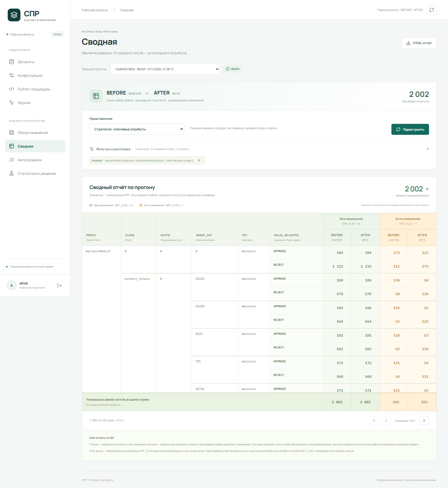

# Компактная сводная стратегии

На странице **«Сводная таблица»** теперь доступно только [дерево всех атрибутов](ATTRIBUTE_TREE.md), без выбора представления. Описанная ниже компактная стратегия остаётся таблицей скачиваемого HTML-отчёта и поддерживается серверным API; отдельного представления стратегии в интерфейсе больше нет.

Представление **«Стратегия · ключевые атрибуты»** показывает семь понятных блоков: решение заявки, решения продуктов (компаний), причина отказа, код причины отказа, вероятность одобрения, целевая модель и порог. На реальном прогоне — 25 строк вместо прежних 116. Список находится в адаптере `scripts/default_spr/pivot_views.py`; вымышленных PD_RETAIL, TAKEUP_RATE_IP и денежных лимитов нет.

Строки сервера группируются по `PATH, VALUE_ADJUSTED`. На экране путь раскрыт в понятный показатель и имя поля (KEY); повторяющиеся названия объединены. Технические PREFIX/SUFFIX/ARRAY_KEY и детальные hit отдельных правил не перегружают готовое представление; их можно выбрать в «Своей раскладке».

| Колонка | Что считает |
|---|---|
| Без изменений · DIFF_FLAG=0 | Уникальные APP_ID по обоим срезам вместе, каждый один раз |
| Есть изменения · BEFORE (MASTER) | Уникальные APP_ID с этим значением в BEFORE и DIFF_FLAG=1 |
| Есть изменения · AFTER (BETA) | Уникальные APP_ID с этим значением в AFTER и DIFF_FLAG=1 |
| Общий итог | Объединение уникальных APP_ID строки по всем колонкам |

Все значения — заявки, не сумма продуктовых попыток или строк офферов. У заявки могут быть разные продукты и значения, поэтому строки и колонки неаддитивны. Особенно важно не удваивать неизменённые значения из двух срезов. В отличие от сумм Excel, итог здесь не равен сумме ячеек, если заявка встречается несколько раз.

На текущем реальном прогоне итоговое APPROVE: **384 / 273 / 112 / 769**, REJECT: **1233 / 112 / 273 / 1618**, в порядке колонок таблицы выше. Общий итог выборки — **2002**, а не сумма итогов строк. Числа вычисляются, не хранятся константами.

Каждая непустая ячейка, итог строки и итог колонки открывают полный список уникальных APP_ID; переход к заявке подсвечивает соответствующие атрибуты. Совпадение бакетов не скрывает изменения исходного значения. Фильтр продукта сохраняет общие атрибуты заявки и исходную привязку продуктовых атрибутов.

Другие представления — итоговое решение заявки, матрица переходов бакетов и своя раскладка — сохранены. Компактный режим применяется к готовой стратегии; произвольные раскладки используют обычные колонки DIFF_FLAG × SOURCE. Существующие витрины не меняются. HTML содержит ту же компактную таблицу полностью, без ограничения страниц.

Короткие проверки: `pytest backend/tests/test_compact_pivot.py backend/tests/test_report.py -q` — 2 passed; браузерные default report, custom layout и HTML export — 3 passed. Проверены повтор заявки в нескольких срезах и атрибутах, изменение внутри бакета, уникальные итоги и переходы, совпадение UI/HTML с API. TypeScript/Vite build прошёл. Серверная агрегация реального прогона — 0.186 с (один замер).

